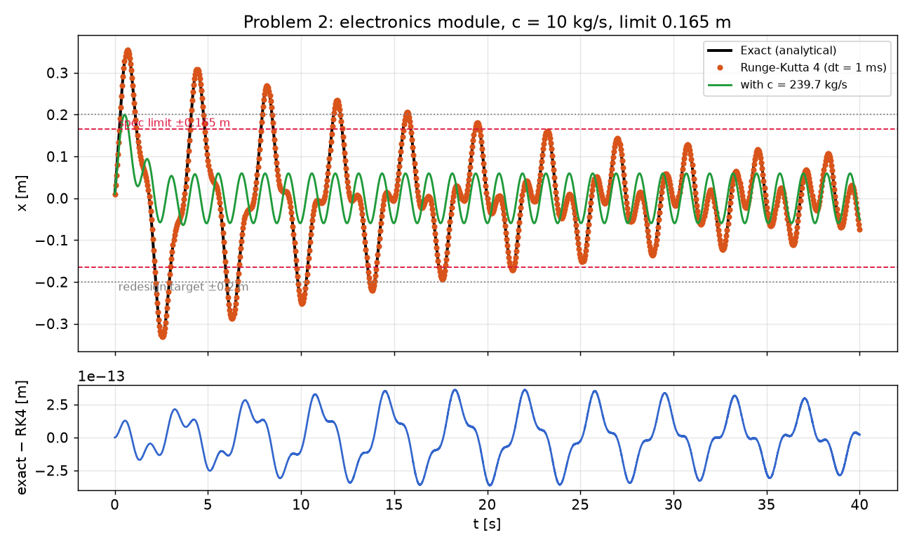
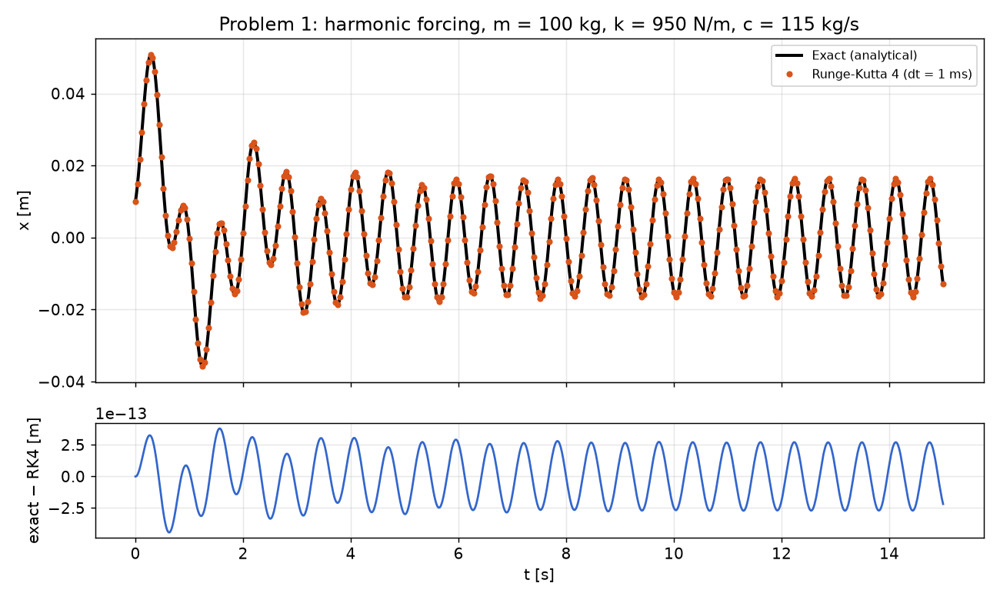
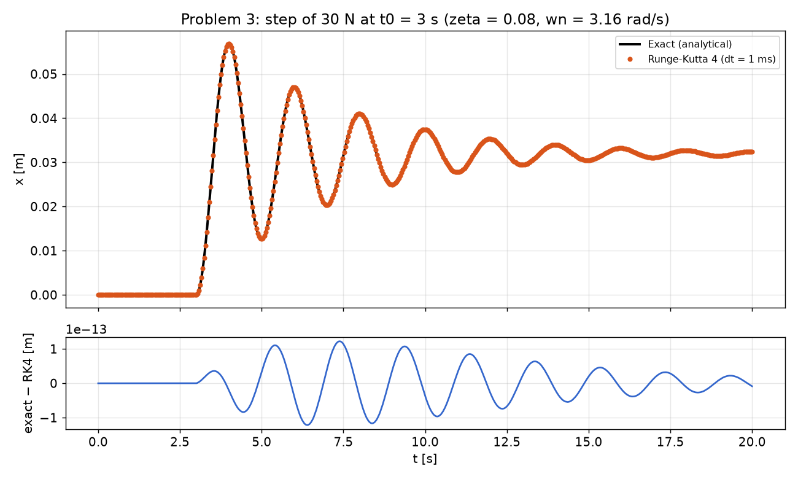
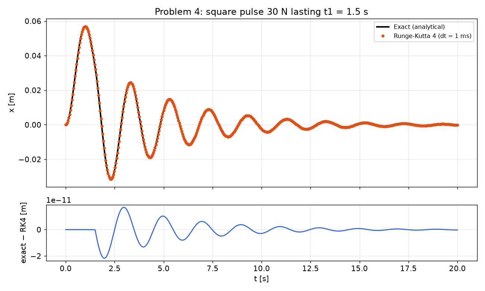
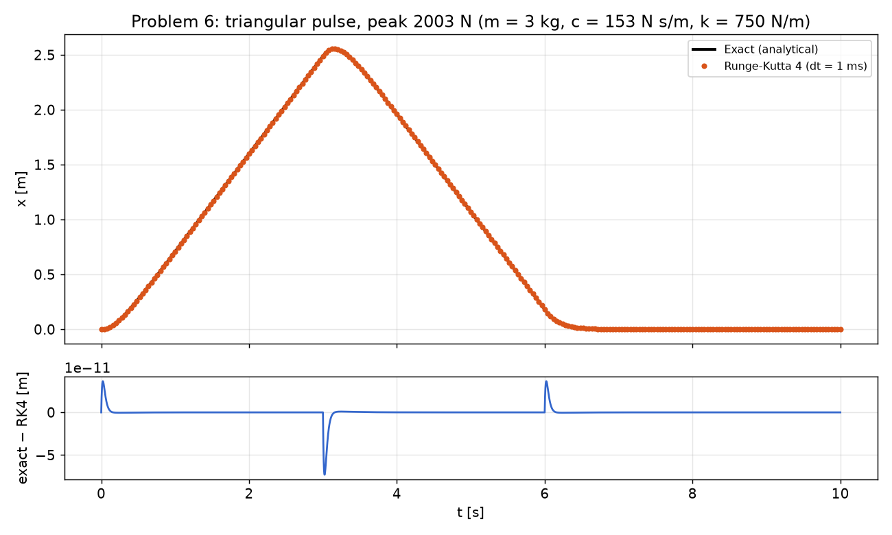

# Single-DOF vibration: exact vs Runge-Kutta solutions

Five forced-vibration problems from Mechanical Vibrations (EML 6223, Florida Atlantic University,
Spring 2025), each solved in closed form and with a hand-written 4th-order Runge-Kutta integrator, then
compared. Parameters use the course's serial-number scheme with S = 3.

**Main finding:** in the electronics-module problem the steady-state amplitude is only 68 mm, comfortably
inside the 165 mm limit, but the start-up transient swings to 355 mm. Checking only the steady state
would pass a design that fails. Meeting the limit needs 349.5 kg/s of damping (ζ ≈ 1.04, just
overdamped) instead of the 10 kg/s supplied; the problem's 0.2 m redesign target needs 239.7 kg/s.



## Results

| Problem | Case | Result (exact solution) | Max abs. difference, exact vs RK4 |
| --- | --- | --- | --- |
| 1 | Harmonic forcing 150 cos(10t) | steady-state amplitude 16.44 mm, phase 3.015 rad; peak displacement 50.9 mm | 4.4e-13 m |
| 2 | Amplitude limit check | steady state 67.7 mm, but transient peak 355 mm > 165 mm limit; min damping 349.5 kg/s for 0.165 m, 239.7 kg/s for 0.2 m | 3.6e-13 m |
| 3 | Step input at t0 = 3 s | static deflection 32.02 mm, peak 56.90 mm (overshoot 78%, theory 78%) | 1.2e-13 m |
| 4 | Square pulse | t1 = 1.5 s: peak 56.90 mm; t1 = 100 s: peak 56.90 mm | 2.2e-11 m |
| 6 | Triangular pulse (overdamped, zeta = 1.61) | peak 2.557 m at t = 3.15 s (quasi-static F0/k = 2.671 m) | 7.3e-11 m |

`results.md` holds the same table, regenerated with the plots every time the script changes.

| | |
| --- | --- |
|  |  |
|  |  |

## Method

- **Exact solutions.** Harmonic forcing: steady-state amplitude and phase plus a transient whose constants
  are fitted to the initial conditions *after* subtracting the particular solution at t = 0. Step, pulse and
  ramp forcing: solved piecewise, where each segment's linear forcing has particular solution A + Bt and the
  state at the end of one segment becomes the initial condition of the next. Under-, critically and
  over-damped cases are all handled.
- **Numerical solutions.** Classic RK4 at a fixed 1 ms step, written out rather than calling a library
  solver. Where the force jumps (steps, pulses), each step samples the force just inside its own interval,
  so the scheme keeps its 4th-order accuracy across the discontinuity.
- **Minimum damping (Problem 2)** is found by bisection on the peak of the full transient-plus-steady
  response, not the steady-state amplitude.

## Parameters (S = 3)

| Problem | m [kg] | c | k [N/m] | Forcing | Initial conditions |
| --- | --- | --- | --- | --- | --- |
| 1 | 100 | 115 kg/s | 950 | 150 cos(10t) N | x0 = 0.01 m, v0 = 0.1 m/s |
| 2 | 100 | 10 kg/s | 285 | 150 cos(5t) N, limit 0.165 m | x0 = 0.01 m, v0 = 0.5 m/s |
| 3 | 93.8 (k/ωn²) | ζ = 0.08 | 937 | 30 N step at t0 = 3 s | at rest |
| 4 | 93.8 | ζ = 0.08 | 937 | 30 N square pulse, t1 = 1.5 s and 100 s | at rest |
| 6 | 3 | 153 N s/m | 750 | triangular pulse, peak 2003 N at 3 s, ends at 6 s | at rest |

Problem 5 is left out: its forcing was defined in a figure that is not in the source material.

## How to run

```bash
pip install -r requirements.txt
python vibrations.py      # writes plots/ and results.md
```

## Notes

This is a reworked version of the original course submission. Re-deriving every case and checking it
against the integrator turned up several slips in the first hand solutions, all corrected here: the Problem 1
transient ignored the particular solution's initial value, Problem 2 judged the limit on the steady state only
(and used ζ = 0.094 where c = 10 kg/s gives 0.030), and the Problem 6 ramp was written as F0·t instead of F0·t/t1.

---
Sai Phanidhar Ammiraju · [More projects](https://github.com/Saiphani02) · [LinkedIn](https://www.linkedin.com/in/sai-ammiraju)
